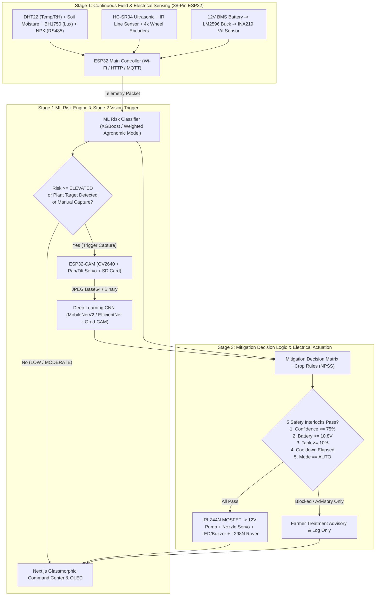
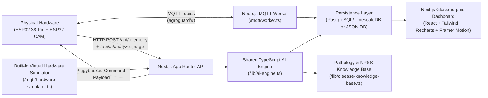
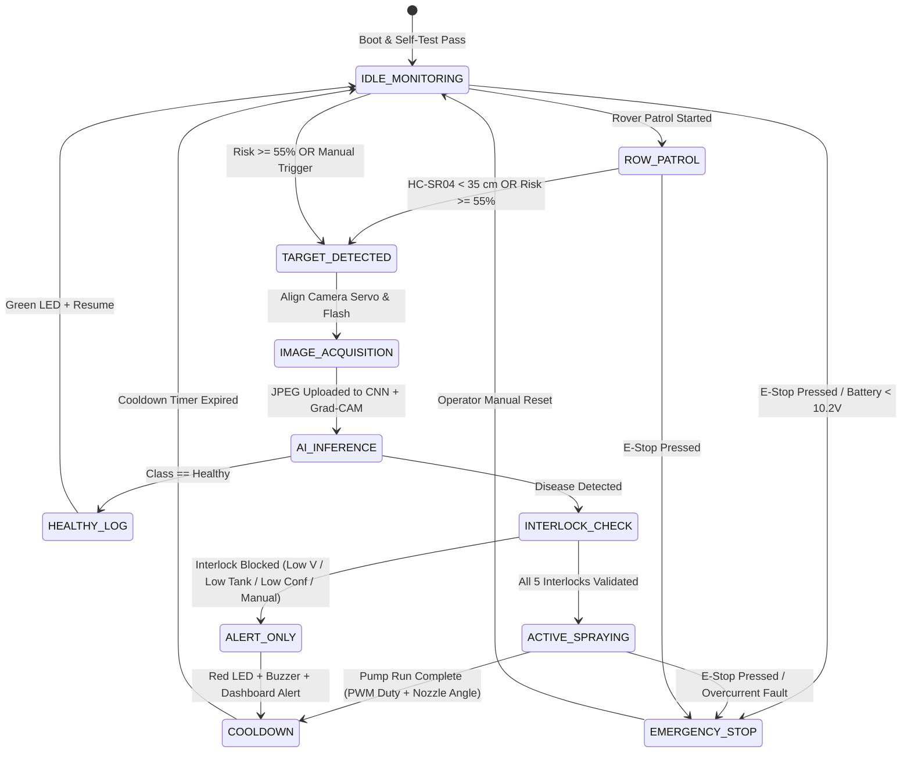

# 02 — System Architecture & Data Flow

This document defines the unified hardware, AI, electrical, and software architecture for the **AI-Based Electrical Support System for Crop Disease Identification and Mitigation**.

---

## 1. End-to-End Two-Stage + Mitigation Pipeline

---

## 2. Software Monorepo & Hardware Bridge Architecture

---

## 3. Automated Mitigation State Machine

---

## 4. Layer Responsibilities

| Layer | Directory / Target | Responsibility |
| :--- | :--- | :--- |
| **Field Sensing & Edge Control** | `firmware/esp32_main_controller/` | Reads physical sensors, controls L298N motors, MOSFET pump, servos, OLED, LED/buzzer; handles local hardware E-Stop. |
| **Edge Vision Node** | `firmware/esp32_cam_node/` | Captures OV2640 frames on risk/obstacle trigger, backs up to microSD, posts image to server. |
| **ML Training & Reference** | `ai-models/` | Python TensorFlow MobileNetV2 + Grad-CAM and environmental risk classifier scripts for offline training & TFLite export. |
| **Ingestion & Protocol** | `mqtt/` & `app/api/` | Bridges physical hardware (MQTT/HTTP) and virtual simulator scenarios into validated TypeScript domain models. |
| **Decision & Knowledge** | `lib/ai-engine.ts`, `lib/disease-knowledge-base.ts` | Stage 1 Risk scoring, Stage 2 image diagnostics, Stage 3 interlock gating, NPSS treatment recommendations. |
| **Storage** | `lib/store.ts` & `docs/06-DATABASE-SCHEMA.sql` | Time-series history for sensors, electrical metrics, detections, rover state, and mitigation logs. |
| **Presentation UI** | `app/`, `components/` | 5-tab dark-mode glassmorphic command center for live monitoring, XAI inspection, rover/pump control, and EE analytics. |
